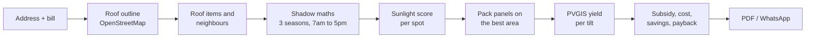

# ☀️ SuryaCheck

[](https://github.com/SwastikKaushal1/SuryaCheck/actions/workflows/ci.yml)
[](LICENSE)


### Will solar actually fit on *your* roof? Find out in three minutes.

SuryaCheck is a rooftop solar planner for Indian homes. Type your address and your electricity bill. It draws your real roof on satellite imagery, adds the water tank and staircase room that shade it, and shows how many panels fit, what they produce, and what you pay after subsidy.

No login. No machine learning. Every number can be explained and checked.

> Built at **Bharat Builds Tour, Environmental Hacks** (Oct 8 to 11, 2026) by **Swastik Kaushal**. Track 03: Waste and Energy.

**🌐 Live app: [d3s69kasxcslyo.cloudfront.net](https://d3s69kasxcslyo.cloudfront.net)** (hosted on AWS: S3 + CloudFront, API on Lambda)

**🎬 Demo video: [youtu.be/wh6qYJc2h3k](https://youtu.be/wh6qYJc2h3k)** (3-minute walkthrough: roof, obstacles, phone skyline scan, solar plan, AWS)

[Run it](#-run-it) · [How it works](#-how-it-works) · [Deploy on AWS](#%EF%B8%8F-deploy-on-aws) · [Report a bug](../../issues)

---

## 💡 The problem

Most Indian homes have a flat RCC roof with a water tank, a staircase room and a parapet. Homeowners can't tell how many panels really fit once those shadows, and taller neighbours, are counted. Vendor quotes mix size, cost and savings in ways that are hard to check. And the PM Surya Ghar subsidy rises up to 2 kW, slows, then stops at 3 kW, so a bigger system is not always a better deal.

SuryaCheck gives a neutral second opinion **before** you call an installer.

## ✨ What you get

| | |
|---|---|
| 🏠 **Your real roof** | Outline found automatically from OpenStreetMap. Wrong? Drag the corners, or tap around the roof yourself. It closes by itself, with no fixed number of points. |
| 🛢️ **Roof items with real shadows** | Water tank, staircase room, AC, dish, tree, keep-clear zones and custom items. Drag on the roof to draw one, then move, resize and rotate it like in a design tool. |
| 🏢 **Tall neighbours** | Place a taller building next door and see the shade it throws in winter. |
| 📏 **Panels drawn to scale** | 2.28 × 1.13 m, 550 W panels, with real dimensions shown on the map and a person-and-ruler scale in the PDF. |
| ☀️ **Sun-aware layout** | Every spot on the roof is scored for sunlight across the year. Panels go on the best-lit area. |
| 📐 **Best tilt, chosen for you** | Real PVGIS yield data for each tilt. No slider to fiddle with. |
| 💰 **Honest money numbers** | Subsidy, cost range, savings and payback, sized to your bill (not to your roof). |
| 📄 **Take it with you** | PDF report for your installer, or a WhatsApp message. English and Hindi. |

## 🔬 How it works



There is **no ML model**. Shadows are geometry plus the sun's position, the yield comes from PVGIS (EU JRC), and the money comes from published tariff and subsidy rules. That is a feature: you can check any number. The heavy lifting runs in your browser, so it is instant and free. See [`docs/CODE_WALKTHROUGH.md`](docs/CODE_WALKTHROUGH.md).

## 🧰 Tech stack

- **Frontend:** Next.js 16, React 19, TypeScript, Tailwind 4, Leaflet
- **Backend:** FastAPI (Python), Lambda-ready through Mangum
- **Data:** PVGIS, OpenStreetMap (Overpass), Nominatim, Esri World Imagery
- **Quality:** unit tests for the plan engine and the API, GitHub Actions CI
- **Packaging:** Docker Compose, bound to localhost only

## 🚀 Run it

### Easiest: Docker

Install Docker Desktop, then from this folder:

```bash
docker compose up --build
```

Open http://localhost:3000. The first build takes a few minutes. Stop with `Ctrl+C`.

Ports are published on `127.0.0.1` only, so the app is **not visible to other devices on your Wi-Fi**.

Editing code? Use live reload instead:

```bash
docker compose -f docker-compose.dev.yml up
```

### Without Docker

You need Node 20+, pnpm and Python 3.10+.

```bash
# terminal 1: backend
cd backend
python -m venv .venv
.venv\Scripts\activate            # Windows  (macOS/Linux: source .venv/bin/activate)
pip install -r requirements.txt
uvicorn main:app --port 8000

# terminal 2: frontend
cd web
cp .env.example .env.local        # points at http://localhost:8000
pnpm install
pnpm dev -H 127.0.0.1             # http://localhost:3000
```

### Tests

```bash
cd web && pnpm typecheck && pnpm test
cd backend && pip install -r requirements-dev.txt && python tests/test_backend.py
```

The same checks run on every push (see the badge above).

## 🗂️ Repository layout

```
SuryaCheck/
├── web/                         Next.js frontend
│   ├── app/                     page shell and global styles
│   ├── components/suryacheck/   screens, map layers, PDF report
│   ├── lib/                     plan engine, solar maths, finance, API client
│   └── tests/                   plan engine tests
├── backend/                     FastAPI service
│   ├── main.py                  routes and error shaping
│   ├── geo.py                   PVGIS, Nominatim, Overpass + caching
│   ├── finance.py               subsidy, cost and payback rules
│   ├── reference.json           tariffs, panel size, subsidy numbers
│   └── tests/                   API tests with outside services stubbed
├── infra/                       AWS deploy: SAM template + one-command script
├── docs/                        how it works, file-by-file walkthrough
├── .github/workflows/ci.yml     tests on every push
└── docker-compose.yml           one-command run
```

## 🔌 API at a glance

| Screen | Backend call |
|---|---|
| Landing | `GET /geocode`, `GET /reverse` |
| Where you live | `GET /quick` (sunshine at the pin) |
| Confirm roof | `GET /building` (outline from OpenStreetMap) |
| Plan | `POST /yield` (PVGIS per tilt), `POST /finance` |
| Shade check | `POST /yield` with a 36-value horizon |
| App start | `GET /reference` (panel size, subsidy, tariffs) |

Errors always come back as `{ "error", "hint" }`.

## 📡 Data sources

| Need | Source |
|---|---|
| Satellite imagery | Esri World Imagery (no key). A plain-map toggle covers areas without imagery. |
| Yearly yield per kW | PVGIS (EU JRC) |
| Address search | Nominatim (India only) |
| Roof outlines | OpenStreetMap through Overpass |

## ☁️ Deploy on AWS

SuryaCheck deploys to AWS with **AWS SAM** (open source) in one command:

```
Browser ─▶ CloudFront ─▶ S3 (static Next.js export, private bucket)
   │
   └─────▶ API Gateway (HTTP API, throttled) ─▶ Lambda (FastAPI via Mangum, Python 3.12)
                                                   ├─▶ PVGIS (solar yield)
                                                   └─▶ OpenStreetMap: Nominatim, Overpass, Photon
```

| Piece | AWS service | Where |
|---|---|---|
| API | Lambda + API Gateway HTTP API, X-Ray tracing, CloudWatch Logs (14 days) | [`infra/template.yaml`](infra/template.yaml) |
| Website | S3 (private, encrypted) + CloudFront (HTTPS, HTTP/3, Origin Access Control) | [`infra/template.yaml`](infra/template.yaml) |
| Build and deploy | AWS SAM CLI + AWS CLI | [`infra/deploy.ps1`](infra/deploy.ps1) |

**You need:** an AWS account, the [AWS CLI](https://aws.amazon.com/cli/) (run `aws configure`), the [AWS SAM CLI](https://docs.aws.amazon.com/serverless-application-model/latest/developerguide/install-sam-cli.html), Docker Desktop (running) and pnpm.

```powershell
powershell -ExecutionPolicy Bypass -File infra\deploy.ps1
```

It stages the backend, builds it in a Lambda-compatible container, deploys the stack to **Sydney (ap-southeast-2)** (accounts made with AWS's new sign-up in India are limited to it; CloudFront still serves the site from Indian edge locations), builds the site with the new API URL, uploads it to S3 and refreshes CloudFront. It prints the website URL at the end. Run it again to ship an update. Options: `-Stack <name> -Region <region>`.

Set a spending alarm first (one time, per AWS account): a $5 monthly budget that emails you at 50% and 80% spent and if the month is forecast to go over. It counts usage before credits, so you are warned even while credits pay.

```powershell
powershell -ExecutionPolicy Bypass -File infra\budget.ps1 -Email you@example.com
```

Notes:
- The API only answers browsers coming from the CloudFront site (and `localhost:3000` for development), via `CORS_ORIGINS`.
- Everything fits the AWS free tier for a demo. To remove it all: empty the site bucket, then `sam delete --stack-name suryacheck --region ap-southeast-2`.

## 🔒 Privacy

No login, no accounts, no analytics, and nothing is saved to a database. Your roof drawing and bill never leave your browser. Your address and pin location are only sent to the public address, roof and sun services listed above to look things up.

## ⚠️ Honest limits

SuryaCheck gives **estimates, not quotations**. Costs, tariffs, subsidy top-ups and net-metering rules vary by state, so confirm them with your DISCOM and installer. Trees are not modelled in the plan (the shade check takes a user-chosen amount), obstacle heights are what you tell it, and OpenStreetMap outline coverage varies. Yield data comes from PVGIS and has not been checked against real meter data.

## 🛣️ What's next

- AWS deployment (Lambda + S3 + CloudFront)
- Panel size choice (for example 1.7 × 1.0 m, 400 W)
- Photo-based obstacle suggestions
- More states' tariffs and subsidy top-ups

## 📜 License

MIT, see [LICENSE](LICENSE). Made by Swastik Kaushal.
